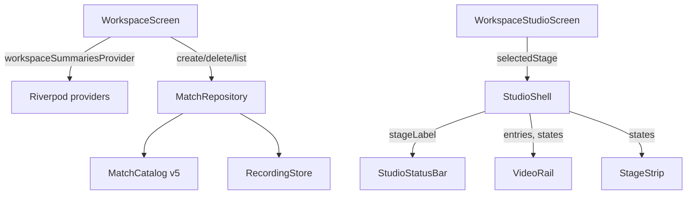

# Architecture — Workspace and Library gaps (G1–G4)

Status: Ideate / Architecture Design
Intent: `261029-implement-brd-feature`
Consumes: `requirements.md`, `feasibility-assessment.md`,
`constraint-register.md`

## 1. Scope of the design

Four presentation/state gaps inside the existing client architecture. No new
component, layer, dependency, protocol method, table, or durable state.

## 2. Options considered

| Option | Shape | Trade-off | Verdict |
| --- | --- | --- | --- |
| A | The shell resolves the stage label and passes it to `StudioStatusBar` as one string input. | Status bar stays a dumb, testable data-in widget (its current shape). Adds one constructor parameter. | **Chosen** |
| B | `StudioStatusBar` reads the studio controller provider itself. | Fewer parameters, but breaks "data-in / callback-out" and spreads provider coupling into a leaf widget. | Rejected |
| C | Add the stage to `VideoStageFacts`. | Makes a domain-ish fact carry a UI selection; the selected stage is ephemeral UI state (ADR-0003 D10). | Rejected |
| D | Put the stage label in the toolbar instead of the status bar. | Contradicts FR-LIB-20 and FR-SHL-14, which name the status bar. | Rejected |

For G2 and G3 the design is a branch swap inside `WorkspaceScreen._body`; for
G4 it is index capture in `_confirmDeleteMatch`. No option space worth
enumerating beyond that.

## 3. Component view

## 4. Data flow

- **G1:** `WorkspaceStudioScreen` owns `selectedStage` through the ephemeral
  studio controller. `StudioShell` maps it to a short, human label (the same
  vocabulary as `stage_strip.dart`) and hands it to `StudioStatusBar`. Play maps
  to `Play`.
- **G2/G3:** `workspaceSummariesProvider` is an `AsyncValue`. Its `loading`
  branch paints a progress indicator; its `error` branch formats
  `"The workspaces could not be read. ${reason}"` and offers Retry.
- **G4:** Before the delete, `_confirmDeleteMatch` records the deleted match's
  index in the currently loaded entries. After `_refresh`, it selects the entry
  now at that index, else the previous entry, else nothing.

## 5. Responsibilities

| Component | Responsibility |
| --- | --- |
| `WorkspaceScreen` | Home states (loading, empty, error, list) and workspace CRUD. |
| `WorkspaceStudioScreen` | Composition root: selection, controller lifetime, delete flows. |
| `StudioShell` | Layout and the data-in/callback-out contract for the panes. |
| `StudioStatusBar` | Render counts, score, stage, readiness; no provider reads. |
| `VideoRail` | List, search, empty/error/loading states for the rail. |

## 6. Failure modes

| Failure | Behavior |
| --- | --- |
| Workspace list read fails | Error state names the failure and the reason; Retry re-reads. |
| Recording missing | Unchanged: honest state, no relocate (ADR-0003 D8). |
| Delete succeeds but refresh fails | The selection falls back through the same index rule; the rail's own error state reports the read failure. |
| Selected entry list is empty after delete | Empty studio state offers Import. |
| Text scaled to 200% | Stage label uses short vocabulary; the status bar must not clip. |

## 7. Security review (security-agent, advisory)

| Finding | Severity | Disposition |
| --- | --- | --- |
| G3 surfaces an exception message in user copy; it may contain a local file path. | Low | Accept. The app is offline and single-user; NFR-13 explicitly wants the file and reason named. No telemetry, so the path stays on the device. |
| No new input crosses a trust boundary; no SQL, network, or process call is added. | — | No action. |
| No secret, token, or machine-specific path is introduced. | — | No action. |

No blocking findings.
