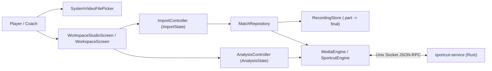
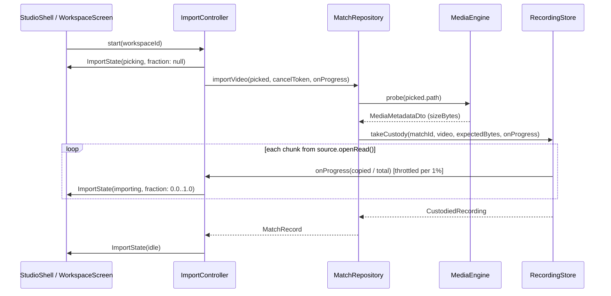
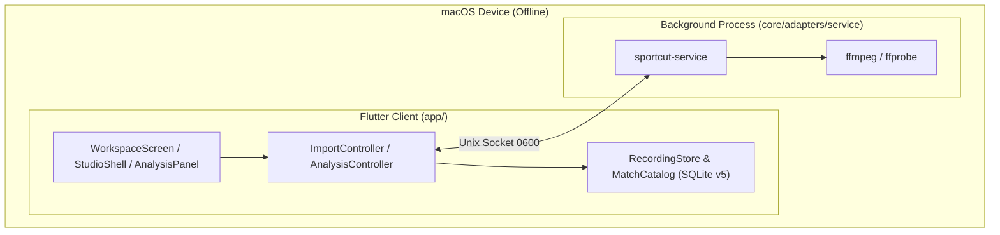

# Architecture Document — Import and Media Preparation (Feature 2)

Status: Ideate / Architecture Design
Intent: `261030-implement-02-import`
Consumes: `../../analyze/requirements-analysis/requirements.md`,
`../../analyze/feasibility-assessment/feasibility-assessment.md`,
`../../analyze/feasibility-assessment/constraint-register.md`

## 1. Option analysis

### Option 1: In-process callback + state getters + scoped artifact row labels (Chosen)

- **G1 (`FR-IMP-15`)**: `RecordingStore.takeCustody` accepts an optional
  `void Function(double fraction)? onProgress` and `int? expectedBytes`. During
  `_copy`, it accumulates `copiedBytes`, computes `(copiedBytes / totalBytes).clamp(0.0, 1.0)`,
  and invokes `onProgress` whenever the rounded percentage `0..100` advances.
  `ImportController` sets `ImportState(phase: ImportPhase.importing, fraction: 0)`
  before starting `importVideo` and updates `state` via `onProgress`.
  `WorkspaceStudioScreen` passes `importFraction: import.fraction` to
  `StudioShell`, and `WorkspaceScreen` passes `fraction: import.fraction` to
  `ScProgressJob`.
- **G2 (`FR-IMP-29`)**: `AnalysisState` adds `rebuildableMissing` (missing
  artifacts whose `kind` is not in `manifest.notRebuildableKinds`) and
  `notRebuildableMissing` (missing artifacts whose `kind` is in
  `manifest.notRebuildableKinds`). `AnalysisPanel` uses `rebuildableMissing` for
  the Rebuild button count and enabled state, and renders a plain-language note
  when `notRebuildableMissing` is non-empty naming each artifact and the stage
  that produces it (`calibration` → Mark court, `tracks` → Player analysis,
  `rally_suggestions` → Review & score, `export` → Export).
- **G3 (`FR-IMP-30`)**: `_ArtifactRow` in `artifact_rows.dart` renders the
  artifact state word (`READY`, `PARTIAL`, `MISSING`) with its reinforcing icon
  and semantic colour in `typography.chrome9`, keeping `ScStatus` and
  `ScPipelineRow` untouched for the studio's pipeline rows.

### Option 2: Polling `.part` file size + mutating `ScStatus` enum (Rejected)

- Polling the `.part` file on a timer introduces race conditions with atomic
  rename and extra filesystem stats during heavy I/O.
- Mutating `ScStatus` labels globally would break `09-studio-shell-jobs-and-settings.md`,
  which requires pipeline stages to read `DONE`, `NEEDS REVIEW`, and `BLOCKED`.

## 2. Diagrams

### 2.1 Context diagram

### 2.2 Component & data-flow diagram

### 2.3 Deployment diagram

## 3. Component responsibilities and failure modes

| Component | Responsibility | Failure handling |
| --- | --- | --- |
| `RecordingStore` | Stream copy to `.part`, report throttled byte fraction `0.0..1.0`, rename atomically, clean up directory on cancel/error. | On `cancelToken.isCancelled` or `FileSystemException`, closes sink, deletes match recording directory, rethrows `MatchImportException`. If `totalBytes <= 0`, skips division-by-zero and reports `0.0` then `1.0` on completion. |
| `ImportController` | Single-flight guard, phase transitions (`idle` → `picking` → `importing` → `idle`), holds `fraction` during `importing`. | Resets `phase` and `fraction` in `finally`; retains `problem` on failure, silent on cancellation. |
| `AnalysisState` / `AnalysisPanel` | Partition missing artifacts into `rebuildableMissing` and `notRebuildableMissing`; drive prepare/rebuild jobs; display non-rebuildable guidance. | Disables Rebuild when `rebuildableMissing.isEmpty` or `busyElsewhere`; shows `ScBanner` on manifest or job failure. |
| `ArtifactRows` | Render each manifest artifact with number, kind, `READY` / `PARTIAL` / `MISSING` badge + icon, decimal size, and relative path. | Handles `sizeBytes == null` with `'—'`. |

## 4. Security review (`security-agent`)

- **Trust boundaries**:
  1. User-picked file path (`PickedVideo.path`): untrusted filename sanitized by
     `RecordingStore._nameFor` (strips path separators and `..`, bounds base
     name to 80 chars, validates extension). Our change adds only byte counting
     during `_copy` and does not alter path sanitization or atomic `.part`
     handling.
  2. Engine protocol boundary (`ArtifactManifestDto.notRebuildableKinds`): values
     originate from the local peer-UID-verified `sportcut-service` and are
     matched against known artifact kind strings (`calibration`, `tracks`,
     `rally_suggestions`, `export`) with a safe fallback for any unknown kind.
- **Findings**: Zero blocking or non-blocking security issues. Offline and
  read-only original-file guarantees (`BR-1`, `BR-2`, `NFR-5`) remain intact.
