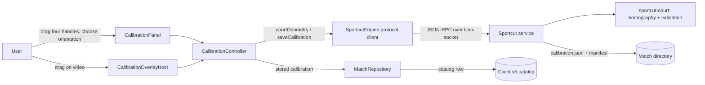
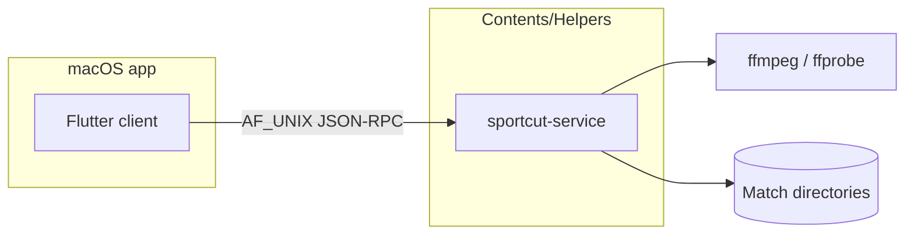

# Architecture Design — Court Calibration (Feature 3)

Status: Ideate / Architecture Design
Intent: `261030-implement-03-court`
Date: 2026-10-30
Inputs: `requirements.md`, `feasibility-assessment.md`, `constraint-register.md`.

## 1. Context

Calibration is a presentation-and-interaction feature inside the existing studio
shell. The engine already owns the homography, validation, and net derivation.
This intent changes only where the returned geometry is drawn and how the
marking surface uses the design contract. No new service, protocol method,
storage, or dependency is introduced.

## 2. Components and responsibilities

| Component | Owns | Does not own |
| --- | --- | --- |
| `CalibrationOverlayHost` | Pointer interaction, active handle, drag lifecycle, box measurement, the single instruction string | Geometry, validation, persistence, panel controls |
| `ScCalibrationOverlay` (design) | Painting the bed/scrim, court outline, dashed net, handles, instruction; hit regions; handle semantics | Controller access, engine calls, save |
| `ScCourtHandle` | One numbered handle, press/drag/hover/focus, accent-on-drag, semantics label | Corner math beyond normalized mapping |
| `CalibrationPanel` | Orientation control, Save/Cancel, problem banner, progress line | Drawing, projection math |
| `CalibrationController` | Per-match state, projection request, save, validation message, geometry storage | Painting, widget layout |
| `SportcutEngine` | Protocol transport for `courtGeometry` and `saveCalibration` | Geometry derivation, catalog writes |
| Design token layer (`SportcutPalette`, `SportcutTokens`, `ScMetrics`, `SportcutTypography`) | Colours, spacing, radii, motion, metrics | Feature behaviour |

## 3. Chosen design

### 3.1 Geometry-driven rendering

`CalibrationState.geometry` is passed into `ScCalibrationOverlay` as an optional
value model containing the four normalized outline corners and the two
normalized net endpoints (derived from `CourtGeometryDto.corners` and `.net`).

- The overlay paints, in order: the fixed bed and scrim, the outline polygon,
  the dashed net, the four handles, and the one instruction line.
- When geometry is null, it paints the bed, handles, and instruction only — no
  outline and no net. This covers the uncalibrated default and every rejection.
- The client-side `_netEndpoints` midpoint derivation is deleted. The only net
  endpoints that exist are the engine's.
- **Guard (S-1/S-2):** engine-supplied geometry is treated as untrusted data.
  Before painting, the overlay requires exactly four outline corners and exactly
  two net points, rejects non-finite values, and clamps every point to 0..1 with
  the existing `_clampPoint`. The dashed painter bounds its loop to a multiple
  of the box diagonal so a pathological endpoint cannot freeze the UI thread.
  The `Clip.none` stack is kept only with these clamps; otherwise the painter
  uses `Clip.hardEdge`.

Rejected alternatives:

| Option | Why rejected |
| --- | --- |
| A second painter layer in the host | Duplicates the aspect-fit box; the overlay already maps normalized points and owns the handles. Drift risk between drag coordinates and painted coordinates. |
| Computing outline/net in the controller | Puts geometry arithmetic in the client, contradicting C-01/NFR-CAL-04 and duplicating the engine. |
| Keeping `_netEndpoints` as a fallback when geometry is missing | Hides the "no projection yet" state and defeats R-CAL-03/R-CAL-04. |

### 3.2 One instruction surface

The overlay keeps a single plain `Text` at `xs12` or larger, with the copy naming
the dashed line as the projected net. The panel loses its instruction paragraph
and `_cornerHints`; the handle semantics labels carry corner order and position.

Rejected alternatives:

| Option | Why rejected |
| --- | --- |
| Keep the hints as micro-labels | The BRD forbids a second instruction block; micro-labels still read as instructions. |
| Move the instruction into the panel | DESIGN.md §6 places it on the overlay; the panel is the inspector, not the action surface. |

### 3.3 Bed, scrim, and accent

The overlay paints the fixed `#0A0F0C` bed and a 32-56 % scrim beneath the
markings, with chalk `#F2F5F0` for the net and handle outlines. The shared
`overlayBed`/`ScOverlayColors.bed` token is corrected from `#050806` after a
consumer scan; if a consumer depends on the old value, a calibration-local token
is used and the deviation is recorded (FR-01).

While the calibrate stage is active, the shared transport keeps working but
drops its accent: the play control, scrub fill, and thumb render neutral. Only
the dragged handle carries the accent (DS-3).

### 3.4 Motion and tokens

`easeStandard = Cubic(0.2, 0.0, 0.0, 1.0)` joins the motion tokens and is used
by the calibration handle/net transitions and the shared transitions the design
contract already names standard. Handle colour and net changes run at the
120/180 ms tokens, and collapse to instant when reduced motion is requested.
Raw `_hairline` and `_handleBorderWidth` move into `ScMetrics`.

## 4. Deployment

No topology change: the client still reaches the engine only through the
existing service socket. The release-service `matchDir` limitation (C-15) is
unchanged and recorded.

## 5. Data flow

1. **Open.** `CalibrationController.open(match)` reads the stored calibration
   from the match record (client v5 catalog), sets corners/orientation/stored,
   and requests a projection. A projection failure surfaces as a problem and
   leaves geometry null.
2. **Drag.** `ScCourtHandle` reports the normalized pointer position;
   `CalibrationController.nudgeCorner` moves only that corner and clamps to
   0..1. The overlay redraws handles from controller state; no engine call.
3. **Release.** `CalibrationOverlayHost._release` asks for one projection. The
   controller stores `CourtGeometryDto`; the overlay now paints the engine's
   outline and net.
4. **Orientation.** `setOrientation` re-requests projection; the drawn net
   changes because it comes from the engine.
5. **Rejection.** The controller catches the engine problem, sets geometry null,
   and shows the message. The overlay drops the outline/net; corners stay.
6. **Save.** `save` writes the artifact through the service and the catalog row
   through the repository, then reports the updated match. On failure the prior
   calibration and the corners remain.

## 6. Failure modes

| Failure | Behaviour |
| --- | --- |
| Engine unreachable or projection fails | Problem banner names the failure; geometry is null; no outline/net; corners remain editable. |
| Invalid geometry (repeated corner, straight line, out of frame, reversed winding, near-zero area) | Engine names the problem; same clearing behaviour. |
| Empty aspect box (zero width/height) | Overlay renders `SizedBox.shrink`; no paint, no crash. |
| Save fails | Previous stored court is preserved; Save re-enables; message names the failure; corners retained. |
| Malformed or out-of-range geometry | The guard rejects the payload (wrong point count, non-finite, out of 0..1); the overlay paints no outline/net and no loop can run away. The corners remain editable. |
| Artifact missing but catalog row present | Opening restores corners from the catalog (FR-CAL-22, current client-owned path). |
| Reduced motion | Transitions collapse; no looping animation. |
| Stripe of bright footage | Bed plus scrim plus chalk ensures 3:1 for essential graphics; contrast calculation recorded. |

## 7. Security review (advisory)

The socket topology is unchanged: the Flutter client talks to the local service
over the Unix socket, and the service keeps its token handshake, same-UID peer
check, 0700/0600 modes, 103-byte `sun_path` guard, validated `matchId`, and
debug-only canonicalized `matchDir`. No new I/O, network, telemetry,
credential, deserialization surface, or dependency is added.

The data flow that *does* change is service → renderer (TB3): the overlay
becomes the first consumer of engine-returned `geometry.corners` and
`geometry.net` for painting. The architecture therefore treats that payload as
untrusted data and requires the client-side guard in §3.1 (point counts,
finiteness, 0..1 clamping, bounded dash iteration). The residual same-user trust
in the local service is recorded as an accepted risk. The earlier wording that
claimed "no input crosses a new boundary" was inaccurate and is superseded by
this paragraph.

Verdict from the `security-agent` review: **pass-with-hardening**, no blocking
findings. Full findings and accepted risks: `security-review.md`.
