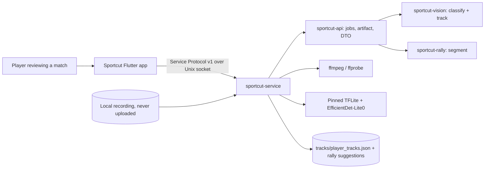

# Architecture Design — Player Tracking (Feature 04)

> **Revision 2026-11-01 — U3 reverted.** Section 3.1 (prediction
> `max_association_radius`, `stale_track_penalty_per_second`,
> `prediction_enabled`, tentative tracks) was implemented and reverted after
> the full-reference checkpoint failed. The metric (3.2), client/contract (3.3),
> boundary validation, and test hardening remain in force.

Status: Ideate / Architecture Design
Intent: `261031-implement-04-player`
Date: 2026-10-31
Inputs: `requirements.md`, `feasibility-assessment.md`, `constraint-register.md`.

## 1. Context

Fragmentation is an association problem, not a detector or storage problem.
Tracking reads sampled frames, classifies each box against the marked court, and
links on-court detections into identities; the track artifact feeds rally
segmentation. This intent changes the association cost and ordering, adds one
measurement summary, corrects the count-quality label, and hardens the
real-footage acceptance test. It adds no service, protocol method, storage,
runtime, model, or dependency.



Deployment topology is unchanged: one local service process, one Unix socket,
the client owns no durable state.

## 2. Options

| Option | Trade-offs | Decision |
| --- | --- | --- |
| **A. Continuity-aware association** | Prediction, a fixed-scale cost, a capped gate, a staleness penalty, fresh-first ordering and tentative tracks. Effort M, reversible, no new dependency or runtime. Effect on the 60% gate is unproven until measured. | **Chosen.** |
| B. Retrospective trajectory stitching | Links disjoint fragments after the fact; needs product sign-off and a no-ambiguous-detection-in-gap rule. Adds a second identity concept. | Deferred by the approved decision; revisit only if A falls short. |
| C. Detection gating / duplicate suppression | Cannot lengthen an identity; reclassifying plausible players games the metric. | Complement only; excluded unless a duplicate/non-person class is demonstrated. |
| D. Larger detector, retraining, or re-ID | One-way door: new weights need licensing rows and a runtime change. | Rejected for this intent. |

## 3. Chosen design

### 3.1 Association

In `tracking.rs`:

- `ActiveTrack` stores velocity from its last two observations. Prediction is
  used when `elapsed <= max_frame_gap_ms`; otherwise the last ground point is
  used.
- The **gate** is `residual <= min(max_ground_speed_per_second × elapsed_s,
  max_association_radius)`.
- **Plausibility** (evidence only) is
  `residual / max_ground_speed_per_second + side_penalty + overlap_penalty`.
- **Ambiguity is decided from plausibility, never from ranking terms.** If the
  top two gate-passing tracks are within `ambiguity_margin` on plausibility, the
  detection is ambiguous: `track_id` stays `None`, no track is spawned, and the
  detection remains in review evidence. This preserves FR-TRK-08 even when a
  fresh and a stale track differ only by the staleness penalty.
- **Assignment ordering** is fresh-confirmed, lost-confirmed, then tentative
  tracks; within a tier, by
  `plausibility + stale_track_penalty_per_second × elapsed_s`. Freshness may
  choose *which* plausible track wins; it may never decide *whether* the match is
  ambiguous.
- Matching is greedy and deterministic (no HashMap order). A resume within the
  gap closes exactly one gap and keeps the ID; an absence beyond it evicts the
  track and produces one new ID on re-entry. A calibration change clears active
  tracks and starts a new coverage segment.
- A track is tentative while its observation count is below the existing
  `min_track_observations`; tentative tracks cannot outrank confirmed ones.

### 3.2 Measurement

`TrackingResult` gains an optional, serde-defaulted `FragmentationSummary`:

| Field | Meaning |
| --- | --- |
| `raw_detections` | Person boxes at or above `min_confidence`, before court classification |
| `on_court_detections` | Every `OnCourt` detection in `review.frames`, including `track_id: None` |
| `distinct_tracks` | Non-null track IDs |
| `top_four_observations` | Sum of the four largest per-ID counts |
| `top_four_share` | `top_four_observations / on_court_detections` (0.0 when empty) |

The engine computes the summary once in `track_detections`. The acceptance test
recomputes the broad share from `review.frames` and asserts it equals the
engine's value; this cross-check verifies the aggregation formula, not the
classifier. The classifier is held honest by two independent floors:

- `on_court_detections` must stay at or above the measured baseline total
  (21,672 over the full reference) and the per-frame mean must stay in the
  measured 5–9 band. A regression that tightens `OnCourt` cannot shrink the
  denominator silently.
- The four top IDs must include both court sides and no single ID may carry more
  than 40% of the top-four observations, so a false join cannot inflate the
  share; count quality must not fall below the measured before value (4.2%)
  while the share improves.

The compact-input share (the 8.7% baseline) is printed for comparability but
never gates.

### 3.3 Client and contract

- `PlayerTracksDto` gains optional `track_quality` and
  `count_supporting_frames`; the Dart model treats both as optional.
- The review panel renames “Coverage” to “Count quality” (FR-TRK-16) and renders
  `Unknown` with quality, supporting frames, and evidence.
- Acceptance-critical floors are service-owned: `min_count_fraction` is rejected
  below 0.60 and `min_track_observations` below 3. The effective values stay in
  provenance.
- The protocol change is a **documentation-only note**: optional fields, no
  method change, unknown fields ignored; no negotiated minor bump. If a future
  change is not optional, both sides bump together.

## 4. Components

| Component | Owns | Changes |
| --- | --- | --- |
| `court_candidates.rs` | OnCourt/Borderline/OffCourt, court point, side | None. The OnCourt rule and margin stay; no reclassification. |
| `tracking.rs` | Identity, gaps, ambiguity, coverage, count, fragmentation | Prediction, gate, plausibility, ordering, tentative tracks, summary. |
| `track_artifact.rs` | Compact input, review evidence, provenance, atomic publish | Carry the summary; keep the short-fragment filter; serde defaults; schema 1. |
| `dto.rs` / `convert.rs` | Client-facing track view and config mapping | Optional summary/count fields; three optional config fields; floor validation. |
| `tracking_panel.dart` / `models.dart` | Review presentation | Count-quality label, Unknown evidence, optional DTO fields. |
| `player_tracking_providers.dart` | Job start | Remove the dead `InferenceAssets` path passing. |
| `real_footage.rs` | Acceptance evidence | Fail-not-skip, RQ-01..RQ-05 assertions, per-stage timing, denominator floors. |
| `sportcut-vision` / `sportcut-rally` tests | Unit evidence | Association, ambiguity, staleness, gaps, coverage, count, segmentation, determinism. |
| `tools/embed-inference-assets.sh` (S2) | Release guard | Fail when MODEL.md and the licensing register disagree or the verdict is not shippable. |

## 5. Data flow

1. `player_tracking_job` samples frames at the requested rate and records the duration.
2. `analyze_sampled_frames` decodes each JPEG and calls the pinned detector.
3. `classify_detections` assigns a decision, ground point, court point and side; only `OnCourt` can be tracked.
4. `track_detections` computes plausibility, decides ambiguity first, then assigns by freshness tier and cost; records gaps, coverage, count and the fragmentation summary.
5. `TrackArtifact::from_tracking` emits only non-ambiguous on-court positions, drops tracks below `min_track_observations`, and embeds the full review and provenance.
6. `save_track_artifact` publishes non-final → temp → rename → final; failure leaves no final artifact.
7. `sportcut-rally::segment` bins per-track motion, applies hysteresis and minimums, and rejects grids over 1,000,000 bins.
8. `real_footage.rs` reads the published artifact and the DTO, recomputes the broad share, and asserts RQ-01..RQ-05 plus timing.

## 6. Interfaces

```rust
// tracking.rs — additive, serde-defaulted (embedded in TrackProvenance.tracking)
pub struct TrackingConfig {
    // existing fields ...
    #[serde(default = "default_max_association_radius")]
    pub max_association_radius: f64,            // 0.25, validated 0 < r <= 0.5
    #[serde(default = "default_stale_track_penalty_per_second")]
    pub stale_track_penalty_per_second: f64,    // 0.5, validated finite >= 0
    #[serde(default = "default_prediction_enabled")]
    pub prediction_enabled: bool,               // true
}

pub struct FragmentationSummary {
    pub raw_detections: usize,
    pub on_court_detections: usize,
    pub distinct_tracks: usize,
    pub top_four_observations: usize,
    pub top_four_share: f64,
}
```

- Old `player_tracks.json` still deserializes: new fields are optional/defaulted,
  `review.fragmentation` is optional, and the artifact stays schema 1.
- `PlayerTrackingConfigDto` gains the same three optional fields; an older
  client payload receives the tuned defaults.
- No method, framing, or error code changes; no negotiated protocol minor.
- The compact `SegmentationInput` is unchanged.

## 7. Security review and resolutions

| Finding | Resolution in this design |
| --- | --- |
| **Blocking:** the staleness penalty could resolve a genuine ambiguity because ambiguity compared the same cost values. | Ambiguity is computed from ranking-independent plausibility; freshness/staleness only order assignment. A fresh-vs-stale unit test asserts `association_ambiguous` and `track_id: None`. Recorded as C-19. |
| **Blocking:** the RQ-01 denominator could shrink with classifier drift; the test and engine read the same frames. | The summary records `raw_detections`; the acceptance test asserts an on-court denominator floor and per-frame band, plus a side/dominance check on the numerator and a count-quality non-regression. Recorded as C-20. |
| **Major:** over-association can inflate the numerator while RQ-02 degrades. | The top-four side/dominance check and count-quality non-regression above. |
| **Major:** licensing is a checklist, not an enforced gate. | S2 adds a guard to `tools/embed-inference-assets.sh` (and/or preflight) that fails when MODEL.md and the register disagree or the verdict is not shippable. C-21. |
| **Minor:** “protocol minor” claim was ambiguous. | Documentation-only note; no version bump because fields are optional and unknown fields are ignored. |
| **Minor:** the acceptance test bypasses the service asset path. | C-16 remains; the existing service rejection test is authoritative. Add a service-level smoke assertion if the test harness allows it. |
| **Minor:** client-supplied acceptance floors. | Service rejects `min_count_fraction < 0.60` and `min_track_observations < 3`. C-22. |

No security boundary is crossed: offline, no new dependency, no FFI/Rust in the
app, no new client durable state, service-owned assets, atomic publication.

## 8. Failure modes

| Mode | Detection | Handling |
| --- | --- | --- |
| Stale capture | Fresh-vs-stale unit test; distinct-ID count | Fixed-scale cost, capped gate, fresh-first ordering; ambiguity unaffected. |
| Player crossing / partner swap | Crossing fixtures; top-four share and distinct IDs | Prediction and side/overlap penalties; genuine ties stay unset rather than guessed. |
| Ambiguous detection | FR-TRK-08 unit test | Unset ID, no spawn, remains in denominator and review evidence. |
| Calibration change | Boundary test | Clear active tracks; never carry an ID across a change. |
| Cancellation / failure | Per-frame cancel checks; atomic publish | No final artifact; temp file never promoted. |
| Nondeterminism | Two-run equality at pure-function level | Output order derives from frame order; deterministic top-four sort. |
| Over-aggressive tuning | All metrics printed together | Do not tune one metric; keep the prediction kill switch; reject false-join-driven share gains. |
| Denominator gaming | Raw/OnCourt floor and per-frame band | Fail the acceptance test; never reclassify a plausible player. |
| Association falls short of 60% | S1 measurement | Stop, record the shortfall; do not move the denominator or add stitching without sign-off. |

## 9. Compatibility

- Tracks schema 1; old artifacts deserialize with defaults.
- New config fields are optional and recorded in provenance automatically.
- DTO additions are optional; no negotiated version change.
- No catalog, manifest, or `SegmentationInput` change.
- No new dependency, network, FFI, or client durable state; layering and no-Rust guards stay green.
- The default engine build without `macos-tflite-eval` still builds and lints.

## 10. Test hooks

- **RQ-01:** unit test on the summary definition; vision continuity test; ambiguity-denominator test; real-footage cross-check and ≥60% gate with denominator floors.
- **RQ-02:** count-floor and Unknown-evidence unit tests; client label/evidence test; artifact assertion.
- **RQ-03:** artifact scan: no non-OnCourt track IDs; every position inside the court margin.
- **RQ-04:** short-track artifact test; real-footage scan.
- **RQ-05:** 30–40 candidates, 10–30% active, min duration on the full reference.
- **RQ-06:** unset skips; set-but-missing assets fails with the fetch instruction.
- **RQ-07:** old-artifact fixture; existing facade tests.
- **RQ-09:** per-stage timing printed; ≤300 s enforced in an optimized build or behind an env.
- **RQ-10:** strict rerun equality for `track_detections` and `segment`.
- **RQ-11:** grid cap, including the boundary case.
- **RQ-12:** ambiguity unset-ID, staleness, one gap + one resume, calibration reset, coverage, count, segmentation edges, config validation.

## 11. Open questions (gate)

- The tuned defaults `max_association_radius = 0.25` and
  `stale_track_penalty_per_second = 0.5` are placeholders until S1 measures them.
- Should the panel display the fragmentation summary, or is it engineering-only?
- Is RQ-05 acceptable as count-fit only until S4 labels a subset?
- Who owns the licensing guard (S2) and the Done sign-off?

## 12. Recommendation

Proceed with option A plus S1 and S3, with the security conditions above
incorporated. B stays deferred, C stays excluded, D stays rejected. The 60%
share is a measurement checkpoint: if A falls short, record it and stop; do not
move the denominator or add stitching without product sign-off.
