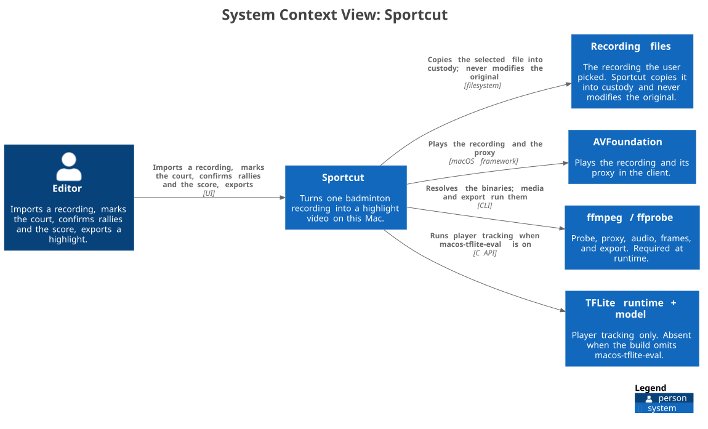

# L1 — System context

Sportcut is a macOS desktop application. One person works on one machine: they
import a recording, mark the court, confirm the rallies and the score, and
export a highlight video. Every step runs on the same Mac, and the recording is
copied into its custody before anything touches it.

## People and software systems

| Element | Type | Responsibility |
| --- | --- | --- |
| Editor | Person | Imports the recording, marks the court, confirms rallies and the score, exports. |
| Sportcut | Software system | Turns one badminton recording into a highlight video on this Mac. |
| Recording files | External system | The user-owned file the editor picks. Sportcut copies it and never modifies the original. |
| AVFoundation | External system | Plays the recording and its proxy inside the client. |

There is no server, database service, identity provider, or messaging system in
the picture, because there is none in the product.

## Relationships

| From → To | Verb | Mechanism |
| --- | --- | --- |
| Editor → Sportcut | Imports, marks, confirms, exports | Desktop UI |
| Sportcut → Recording files | Copies into custody | Filesystem read; the original is never written |
| Sportcut → AVFoundation | Plays the recording and the proxy | macOS framework, inside the client process |

## What the picture deliberately leaves out

- **No cloud.** There is no cloud service, telemetry endpoint, or online API on
  any path. There is no offline cache to sync or account to sign into.
- **No model download at runtime.** Inference assets are fetched at build time
  and shipped in the bundle; see [background-service.md](../background-service.md).
- **No multi-user model.** Matches belong to the machine, not to an account.

## Boundaries

The system boundary is the Mac. Everything that matters about trust sits inside
it: the client and the background service are separate processes on the same
machine, and they talk over a Unix socket that never listens on a network
interface. [L2 — containers](02-containers.md) opens that boundary.

The product decision behind the semi-automatic workflow — the app proposes, the
user confirms — is recorded in
[ADR-0001](../../adr/0001-rust-background-service.md).
