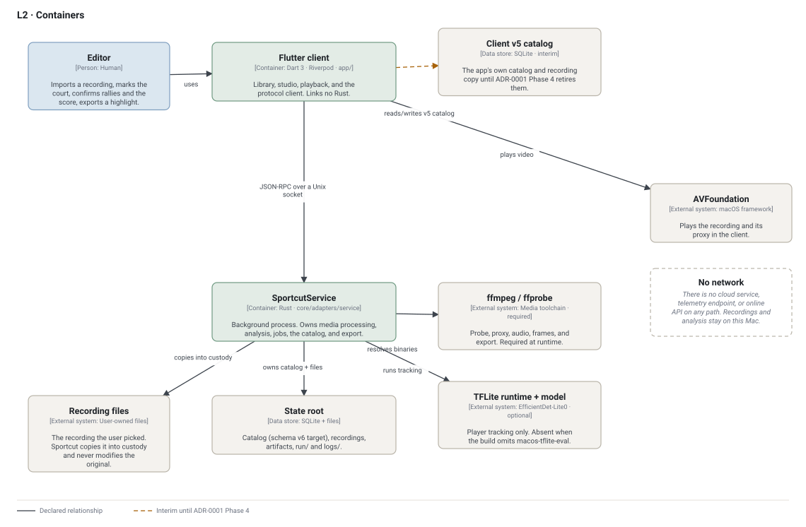

# L2 — Containers

Two processes and the data they own. The Flutter client draws the product; the
Rust service does the work. They share no memory and link no library: the only
path between them is the protocol on a Unix socket.

## Containers and data stores

| Container | Technology | Responsibility | Code |
| --- | --- | --- | --- |
| Flutter client | Dart 3, Riverpod, Flutter macOS | Library, studio, playback, and the protocol client. Links no Rust. | `app/` |
| SportcutService | Rust, separate process | Media processing, analysis, jobs, catalog, export. One heavy job at a time. | `core/adapters/service` |
| State root | SQLite + files | Catalog, recordings in custody, artifacts, jobs, logs, socket and token. | `<state-root>/` at runtime |
| Client v5 catalog | SQLite, interim | The app's own catalog and recording copy until ADR-0001 Phase 4 retires them. | `app/lib/src/features/library/data/match_catalog.dart` |

`ffmpeg`/`ffprobe`, the TFLite runtime with the person model, and AVFoundation
are outside the system boundary: the service invokes the first two, the client
uses the third. `ffmpeg` is required at runtime; the inference assets are
optional and only player tracking needs them.

## Relationships

| From → To | Verb | Mechanism |
| --- | --- | --- |
| Editor → Flutter client | Imports, marks, confirms, exports | Desktop UI |
| Flutter client → SportcutService | Sends protocol methods | JSON-RPC framing over a Unix socket, Sportcut Service Protocol v1 |
| Flutter client → AVFoundation | Plays the recording and the proxy | macOS framework |
| Flutter client → Client v5 catalog | Reads and writes its own catalog | SQLite, **interim** |
| SportcutService → State root | Owns the catalog, custody, jobs, artifacts | SQLite and filesystem |
| SportcutService → Recording files | Copies the selected file into custody | Filesystem read; the original is never written |
| SportcutService → ffmpeg/ffprobe | Resolves the binaries; media and export run them | Child process |
| SportcutService → TFLite | Runs player tracking when enabled | C API, optional per build |

## Trust boundary

- The service listens on a Unix socket only. There is no TCP listener and the
  app carries no network entitlement.
- The socket directory is `0700` and the socket and token file are `0600`; the
  service checks the peer's UID before serving a request.
- One service instance per state root, enforced with an exclusive `flock`.
- The app never links Rust, never loads a dylib, and never sends a path to the
  inference runtime or model. `tools/check-no-rust-in-app.sh` fails the build if
  that changes.
- The service accepts `--ffmpeg`, `--ffprobe`, `--tflite-library`, and
  `--person-model`; absent inference flags resolve bundle files, then the
  environment.

The process model, lifecycle, and failure handling are in
[background-service.md](../background-service.md). The wire contract is
[protocol.md](../protocol.md).

## Data ownership and the migration

Per ADR-0001 the target is that the service owns the SQLite catalog (schema v6
adopting v5), recording custody, jobs, artifacts, and export, while the client
keeps only an in-memory cache and playback. That is the direction of the
migration, not all of it is done:

- The **state root** (service-owned) is the target home for the catalog and the
  recording store.
- The **client v5 catalog** still exists and still holds the app's rows and its
  recording copy. Every edge touching it is drawn dashed, and no new durable
  client-owned state may be added.
- `library.calibration.save` is declared in the protocol but not yet served; the
  client still writes its own catalog row after `engine.calibration.save`.

The phased plan and its parity gates are in
[migration-from-ffi.md](../migration-from-ffi.md).
