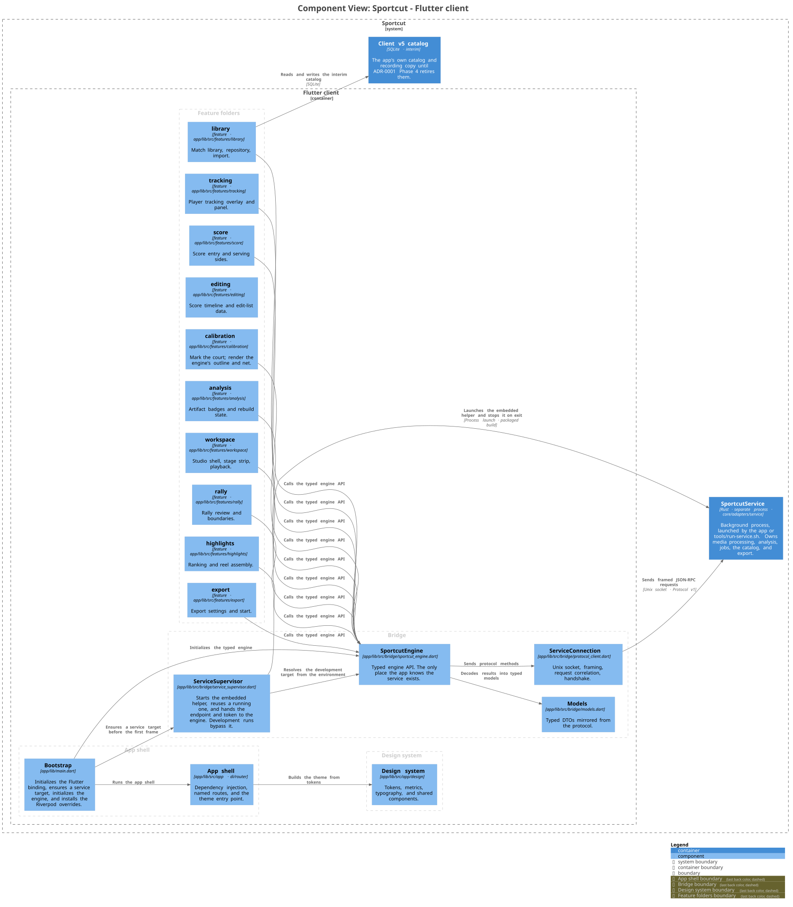

# L3 — Components: Flutter client

The client is organised by feature. Each folder under
`app/lib/src/features/` owns one screen or workflow; shared presentation lives
in the design system; one bridge knows that the engine is a separate process.

## Feature folders

| Component | Path | Responsibility |
| --- | --- | --- |
| analysis | `features/analysis` | Artifact badges and rebuild state. |
| calibration | `features/calibration` | Mark the court; render the engine's outline and net. |
| editing | `features/editing` | Score timeline and edit-list data. |
| export | `features/export` | Export settings and start. |
| highlights | `features/highlights` | Ranking and reel assembly. |
| library | `features/library` | Match library, repository, import. |
| rally | `features/rally` | Rally review and boundaries. |
| score | `features/score` | Score entry and serving sides. |
| tracking | `features/tracking` | Player tracking overlay and panel. |
| workspace | `features/workspace` | Studio shell, stage strip, playback. |

A feature is free to have `domain/`, `data/`, and `presentation/` subfolders; a
later phase lands inside its folder instead of spreading across the app.

## Supporting components

| Component | Path | Responsibility |
| --- | --- | --- |
| Bootstrap | `app/lib/main.dart` | Initializes the binding, ensures a service target, initializes the engine, installs the Riverpod overrides, and runs the shell. |
| App shell | `app/lib/src/app` (`di.dart`, `router.dart`) | Dependency injection, named routes, and the theme entry point. |
| Design system | `app/lib/src/app/design` | Tokens, metrics, typography, colour, and shared components. |
| ServiceSupervisor | `bridge/service_supervisor.dart` | Starts the embedded helper in a packaged build, reuses a running one, and hands the endpoint and token to the engine. |
| SportcutEngine | `bridge/sportcut_engine.dart` | Typed engine API. The only place the app knows the service exists. |
| ServiceConnection | `bridge/protocol_client.dart` | Unix socket, length-prefixed framing, request correlation, `service.hello` handshake. |
| Models | `bridge/models.dart` | Typed DTOs mirrored from the protocol. |
| Client catalog | `features/library/data/match_catalog.dart` | Interim v5 catalog; service-owned from ADR-0001 Phase 4. |

## Rules the picture encodes

- **Only the bridge talks to the engine.** Feature code never opens a socket and
  never hard-codes a protocol method. Every feature that reaches the engine has
  its own edge to `SportcutEngine`; `editing` works on already-loaded data and
  has none.
- **Bootstrap is the composition root.** `main.dart` asks the supervisor for a
  target, initializes the engine with it, and only then runs the shell.
- **Development and packaged launches meet at the same contract.** With
  `SPORTCUT_ENDPOINT` or `SPORTCUT_STATE_ROOT` set, the supervisor returns the
  environment target and launches nothing. Without them, it starts
  `Contents/Helpers/SportcutService` against
  `Application Support/Sportcut/state`, reuses a helper that already answers,
  and stops the one it started. Both paths end at `SportcutEngine.initialize`.
- **Everything renders through the design system.** Feature code takes its
  colours, spacing, type, and motion from tokens and shared components; it does
  not carry raw hex values or ad-hoc pixel constants (DS-1). The diagram draws
  the design system once, reached from the app shell, rather than one edge per
  feature.
- **Riverpod is the wiring.** Shared state and dependencies are providers in
  `app/lib/src/app/di.dart`; a feature does not construct the engine itself.
- **The client owns no durable state that belongs to the service.** The v5
  catalog is the one exception, drawn as an interim dashed edge. Do not add
  another.

## The service is still the engine

The client sends protocol methods and decodes results; it computes no media,
geometry, or score rules. The wire contract is [protocol.md](../protocol.md);
the methods are defined once in `core/gateways/protocol` and mirrored in the
bridge. The component view shows the `SportcutService` container so the bridge
has a visible endpoint: `ServiceConnection` crosses the process boundary, and
`ServiceSupervisor` is the only other component that touches the service
process.
