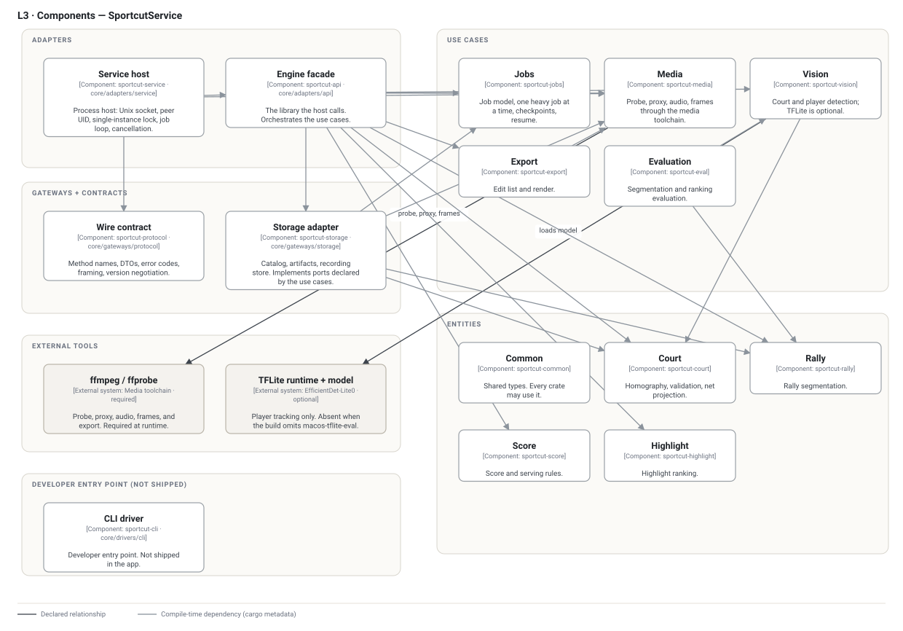

# L3 — Components: SportcutService

The Rust crates inside the background service, grouped by the layer each one
lives in. The arrows between crates are the compile-time dependencies declared
in `core/Cargo.toml`; `tools/check-c4-model.sh` compares the workspace with
`cargo metadata` in both directions and fails on a missing or invented
dependency.

## Components

| Layer | Component | Crate | Responsibility |
| --- | --- | --- | --- |
| Adapter | Service host | `sportcut-service` | Unix socket, peer UID, single-instance lock, request loop, job loop, cancellation, checkpoint resume. |
| Adapter | Engine facade | `sportcut-api` | The library the host calls; orchestrates the use cases. |
| Gateway | Wire contract | `sportcut-protocol` | Method names, DTOs, error codes, framing, version negotiation. No dependency on anything else. |
| Gateway | Storage adapter | `sportcut-storage` | Catalog, artifacts, recording store; implements the ports declared by the use cases. |
| Use case | Jobs | `sportcut-jobs` | Job model, one heavy job at a time, checkpoints, resume. |
| Use case | Media | `sportcut-media` | Probe, proxy, audio, frames through the media toolchain. |
| Use case | Vision | `sportcut-vision` | Court and player detection; TFLite is optional. |
| Use case | Export | `sportcut-export` | Edit list and render. |
| Use case | Evaluation | `sportcut-eval` | Segmentation and ranking evaluation. |
| Entity | Common | `sportcut-common` | Shared types. Every crate may use it. |
| Entity | Court | `sportcut-court` | Homography, validation, net projection. |
| Entity | Rally | `sportcut-rally` | Rally segmentation. |
| Entity | Score | `sportcut-score` | Score and serving rules. |
| Entity | Highlight | `sportcut-highlight` | Highlight ranking. |

`core/drivers/cli` (`sportcut-cli`) is a developer entry point, not part of the
shipped service. It is drawn at the bottom and its edges are omitted.

## What the arrows mean

- **Outer may depend on inner, never the reverse.** Adapters → gateways and use
  cases → entities. The rule and its enforcement are in
  [layering.md](../layering.md) and `tools/check-layering.sh`.
- **Edges to `sportcut-common` are omitted.** Every crate may use it, so
  fourteen identical arrows would hide the structure that matters. The checker
  applies the same exclusion on both sides, so the omission is a stated rule,
  not a blind spot.
- **The storage arrows point outward on purpose.** `sportcut-storage` depends on
  `sportcut-jobs`, `sportcut-media`, and `sportcut-rally` because it implements
  ports those crates declare. A use case never depends on the gateway that
  implements its port; the gateway depends on the use case's contract.
- **One declared adapter exception.** `sportcut-service` depends on
  `sportcut-api` and on `sportcut-protocol`. The host is the composition root:
  it wires the facade to the socket. This is the single exception recorded in
  ADR-0002.

The picture is dense by design; it is the dependency set, not a summary.
`docs/architecture/layering-diagram.html` remains the authoritative edge audit
because it classifies every edge as inward, violation, or declared.

## External tools

| Tool | Used by | Why |
| --- | --- | --- |
| `ffmpeg` / `ffprobe` | `sportcut-media` (and `sportcut-export` through it) | Probe, proxy, audio, frames, render. Resolved by the service, required at runtime. |
| TFLite runtime + EfficientDet-Lite0 | `sportcut-vision` | Player tracking only, behind `macos-tflite-eval`. |

The service resolves the tool paths and reports their versions; the client never
supplies them. See [background-service.md](../background-service.md) §Tools.
