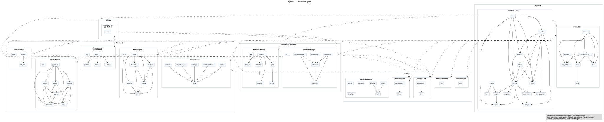

# L4 — Code

The code level is a generated module graph, not a hand-drawn class diagram.
Structurizr has no code level, so `tools/generate-c4-diagrams.sh` derives this
view from `cargo metadata` and the Rust source itself and writes
`generated/l4-code.svg`. It is a static SVG outside the Structurizr workspace;
open it directly or from this page.

## What the diagram shows

- **Packages** are crates, nested under the layer that owns them: entities, use
  cases, gateways and contracts, adapters, and drivers.
- **Boxes** are the Rust source modules under each crate's `src/`, one box per
  file.
- **Solid arrows** are `use crate::` references between modules in one crate.
- **Dashed arrows** are `use sportcut_*` references between crates.
- **Edges to `sportcut-common` are omitted**, matching the L3 rule: every crate
  may use it, so the arrows would hide the structure that matters.
- `sportcut-cli` and `sportcut-eval` are marked `«developer-only»`; they are not
  part of the shipped service.

The picture is a dependency view, not a call-order view. It answers "which
modules know about which other modules" and "which crates does this code cross",
not "what runs first".

## Why generated instead of modelled

Structurizr models systems, containers, and components; it cannot express a
class or module diagram. Keeping a second hand-maintained L4 beside the code
would drift from it, which is exactly the failure the C4 set is designed to
avoid. Generating the view from the same source the compiler reads makes drift
impossible: if a module is added, removed, or rewired, the diagram changes with
it.

The consequences:

| Question | Where |
| --- | --- |
| Which layer does a crate belong to, and what may depend on what? | [layering.md](../layering.md) |
| Show me every crate edge, classified inward / violation / declared | [layering-diagram.html](../layering-diagram.html) |
| Show me the module graph inside and across the crates | [generated/l4-code.svg](generated/l4-code.svg) |
| Does the code still obey the layering rule? | `tools/check-layering.sh` |
| What goes over the socket, field by field? | [protocol.md](../protocol.md) and `core/gateways/protocol` |

## Scope

The view covers the Rust engine (`core/`). The Flutter client's code level is
not drawn: its L3 view already maps every feature folder and the bridge, and a
Dart module graph would need a separate extractor and renderer. The wire contract
is documented field by field in [protocol.md](../protocol.md), which is more
useful than a Dart type graph.

## When to add a focused diagram

The generated view stops at modules and references. A focused UML or state
diagram is still worth adding when a component's internals are the risk — a
state machine with non-obvious transitions, a retry or recovery path, or a
concurrency protocol. Keep it beside the code that implements it and link it
from the L3 page rather than widening the generated graph.

Candidates in this codebase:

- the job loop and checkpoint resume in `core/use-cases/jobs`;
- the import/cancel/reconnect supervision in `core/adapters/service`;
- the protocol frame codec in `core/gateways/protocol`.
